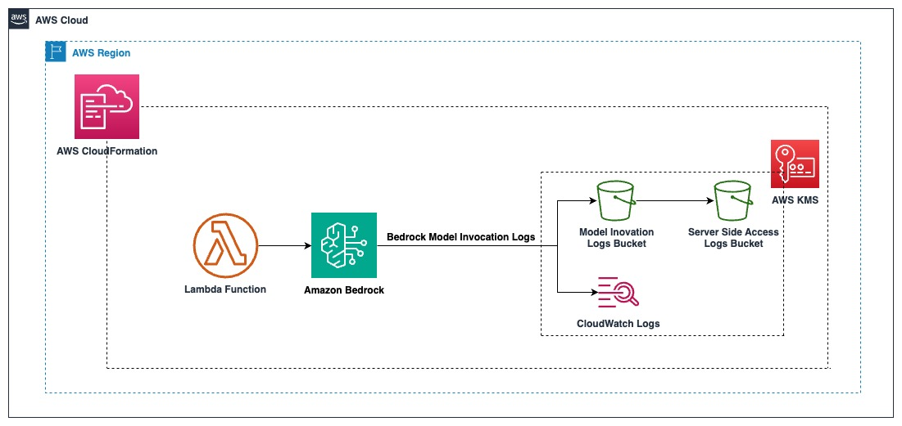

# enable-bedrock-logging-using-cloudformation

## Description
This AWS CloudFormation template enables the Model Invocation Logging in Amazon Bedrock. This template provisions required S3 buckets,
CloudWatch Logs Log Group, KMS key and custom CloudFormation resource backed by AWS Lambda to enable the Amazon Bedrock Model Invocation logging. 

## Architecture


This AWS CloudFormation template provisions necessary resources for Amazon Bedrock Invocation logging as follows:
+ AWS KMS Key for encryption of log data in S3 buckets and CloudWatch Logs Log group
+ S3 buckets for storage of model invocation logs and server side access logs
+ CloudWatch Logs Log Group for storage of model invocation logs
+ Service IAM role for Amazon Bedrock
+ Lambda Function to call Bedrock API as a custom resource to enable Bedrock Model Invocation logging
+ Lambda Function enables following logging configuration
    + Text Data Delivery
    + Image Data Delivery
    + Embedding Data Delivery
    + Video Data Delivery
+ Enables logging to CloudWatch Logs Group and S3 bucket

## List of Resources Created
|   Resource Logical ID                         |   Resource Type                           |
| --------------------------------------------- | ----------------------------------------- |
|   rBedrockInvocationLogsBucket                |	AWS::S3::Bucket                         |
|   rBedrockInvocationLogsBucketPolicy          |	AWS::S3::BucketPolicy                   |
|   rBedrockLoggingKey                          |	AWS::KMS::Key                           |
|   rBedrockLoggingKeyAlias                     |	AWS::KMS::Alias                         |
|   rBedrockLoggingLambdaExecutionRole          |	AWS::IAM::Role                          |
|   rBedrockLoggingLambdaFunction               |	AWS::Lambda::Function                   |
|   rBedrockLogGroup                            |	AWS::Logs::LogGroup                     |
|   rBedrockServiceRoleForLogging               |	AWS::IAM::Role                          |
|   rBedrockServiceRoleForLoggingDefaultPolicy  |	AWS::IAM::Policy                        |
|   rInvokeLambda	                            |   AWS::CloudFormation::CustomResource     |
|   rServerAccessLogsBucket	                    |   AWS::S3::Bucket                         |
|   rServerAccessLogsPolicy	                    |   AWS::S3::BucketPolicy                   |

## Parameters
|   Parameter                           |   Default                                     |   Description                                                                                                 |
| ------------------------------------- | --------------------------------------------- | ------------------------------------------------------------------------------------------------------------- |
|   pKMSKeyAlias                        |   `alias/bedrock-logs`                        |   Alias for the KMS key used to encrypt the model invocation logs                                             |
|   pBedrockLogGroupName                |   `/aws/bedrock/model-invocations`            |   Name of the CloudWatch Logs log group for model invocation logs                                             |
|   pLogRententionCloudWatchLogGroup    |   `90`                                        |   Number of days to retain logs in CloudWatch Logs                                                            |
|   pBedrockLogsBucket                  |   `bedrock-model-invocation-logs-bucket`      |   Name of the S3 bucket for model invocation logs. Region and account ID are appended to the name.            |
|   pBedrockServerAccessLogsBucket      |   `bedrock-server-access-logs-bucket`         |   Name of the S3 bucket for server access logs of the invocation logs bucket. Region and account ID are appended to the name. |

## Deployment
Model invocation logging is configured per region, so deploy the stack once in each region where you use Amazon Bedrock. The template creates IAM roles, so `CAPABILITY_IAM` is required.

```bash
aws cloudformation deploy \
  --region <region> \
  --stack-name BedrockLogging \
  --template-file enable-bedrock-logging-using-cloudformation.yaml \
  --capabilities CAPABILITY_IAM
```

To override a default, add `--parameter-overrides pLogRententionCloudWatchLogGroup=365`.

Verify that logging is enabled:

```bash
aws bedrock get-model-invocation-logging-configuration --region <region>
```

## Deleting the Stack
+ Deleting the stack disables Amazon Bedrock model invocation logging in that region.
+ The KMS key, the CloudWatch Logs log group and both S3 buckets have `DeletionPolicy: Retain` and are not deleted with the stack.


## Security
This solution is provided as a proof-of-value and is not intended as a production-ready implementation. You are responsible for evaluating how the AWS Shared Responsibility Model applies to your specific use case and for implementing the necessary security controls to meet your organization's requirements. AWS provides a broad set of security tools and configurations to support your security objectives, and it is your responsibility as the developer to ensure all aspects of your application are appropriately secured for production use.


## License
Refer to [LICENSE](LICENSE) for licensing information.

